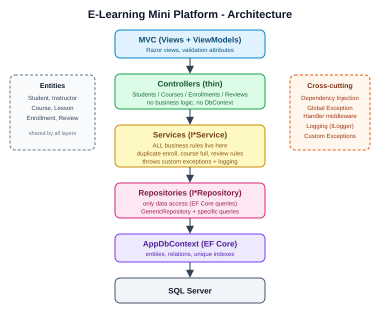

# E-Learning Mini Platform

A small e-learning system built with **ASP.NET Core MVC (.NET 8)** and **EF Core + SQL Server**.
The goal of the project is not the e-learning domain itself, but a clean, professional layered
architecture: **Controller → Service → Repository → DbContext → SQL Server**.

## Features

- **Students**: add, edit, delete, list, details.
- **Courses**: add, edit, delete, list, details (name, description, price, instructor, maximum students).
- **Enrollment**: a student can enroll in a course.
  - ❌ cannot enroll in the same course twice
  - ❌ cannot enroll when the course reached its maximum capacity
- **Reviews**: a student can review a course.
  - ❌ only if enrolled in the course
  - ❌ only once per course
  - ✅ rating from 1 to 5, comment is optional

Entities: `Student`, `Instructor`, `Course`, `Lesson`, `Enrollment`, `Review`.

## Architecture



```
MVC → Controllers → Services → Repositories → DbContext → SQL Server
```

| Layer | Responsibility | Folder |
|---|---|---|
| Controllers | Bind input, call a service, return a view/redirect. No business logic, no `DbContext`. | `Controllers/` |
| Services | **All business rules**, custom exceptions, logging. Depend only on interfaces. | `Services/`, `Services/Interfaces/` |
| Repositories | Data access only (EF Core queries). | `Repositories/`, `Repositories/Interfaces/` |
| Data | `AppDbContext`, entity configuration, unique indexes, seed data. | `Data/` |
| Models | Entities. | `Models/` |
| ViewModels | Input/output shapes for views, validation attributes. | `ViewModels/` |
| Cross-cutting | Global exception handler, DI registration, constants. | `Middleware/`, `Extensions/`, `Common/`, `Exceptions/` |

### Why this architecture?

- **Separation of concerns**: each class has one reason to change (Single Responsibility).
- **Testability**: services depend on interfaces (`IStudentRepository`, ...), so repositories can be mocked in unit tests.
- **Dependency Inversion**: controllers depend on `I*Service`, services depend on `I*Repository`; concrete classes are wired once in `Extensions/ServiceCollectionExtensions.cs`.
- **Replaceable data access**: switching from EF Core/SQL Server to another store only touches the repositories.
- **Business rules in one place**: rules such as "course is full" or "already reviewed" live in the services and nowhere else.

### Enrollment flow (what the service decides)

```
Student exists? → Course exists? → Already enrolled? → Course full? → Enroll
```

Each failed rule throws a custom exception (`NotFoundException`, `AlreadyEnrolledException`,
`CourseFullException`, `NotEnrolledException`, `DuplicateReviewException`, `InvalidRatingException`).
Controllers show business-rule messages to the user; anything unhandled goes to the
**global exception handler** (`ExceptionHandlingMiddleware`) which logs it and returns a clean error page.

## Technologies

- .NET 8, ASP.NET Core MVC (Razor views)
- Entity Framework Core 8 + SQL Server (LocalDB by default)
- Built-in Dependency Injection and `ILogger`
- Bootstrap 5 (CDN)

## Project structure

```
ELearningPlatform/
├── Common/            BusinessRules.cs (constants, no magic numbers)
├── Controllers/
├── Data/              AppDbContext
├── Exceptions/        Custom exceptions
├── Extensions/        DI registration
├── Middleware/        Global exception handler
├── Models/            Entities
├── Repositories/      + Interfaces/
├── Services/          + Interfaces/
├── ViewModels/
├── Views/
└── docs/              Architecture diagram
```

## How to run

Requirements: .NET 8 SDK and SQL Server (LocalDB, Express or full).

1. Clone the repo and open the project folder.
2. Edit the connection string in `appsettings.json` if you are not using LocalDB.
3. Run:

   ```bash
   dotnet restore
   dotnet run
   ```

4. Open the URL shown in the console (e.g. `https://localhost:5001`).

The database is created automatically on first run (`EnsureCreated`) and two instructors are seeded.

### Using migrations instead (recommended for real projects)

```bash
dotnet tool install --global dotnet-ef
dotnet ef migrations add InitialCreate
dotnet ef database update
```

Then replace `EnsureCreated()` in `Program.cs` with `Database.Migrate()`.

## Clean-code checklist

- [x] Controllers are small
- [x] Every feature has a Service, every Service has an Interface
- [x] Dependency Injection everywhere
- [x] No business logic and no `DbContext` in controllers
- [x] No duplicated CRUD code (`GenericRepository<T>`)
- [x] No magic numbers (`BusinessRules`)
- [x] Custom exceptions + Global exception handler
- [x] Logging with `ILogger`
- [x] Business rules inside services
- [x] Clear names

## Notes

- The "current user" is chosen from a dropdown (no authentication) to keep the focus on the architecture.
- Unique indexes on `(StudentId, CourseId)` for enrollments and reviews act as a database-level safety net
  against duplicates in case of concurrent requests.
