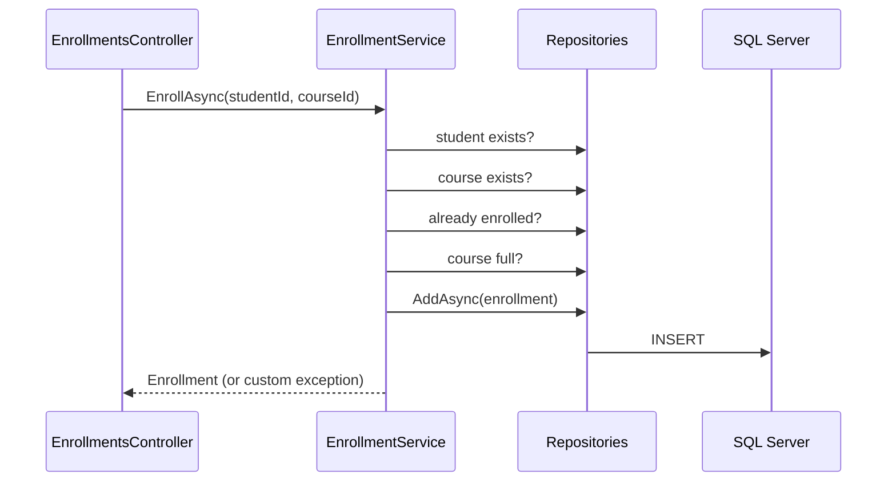
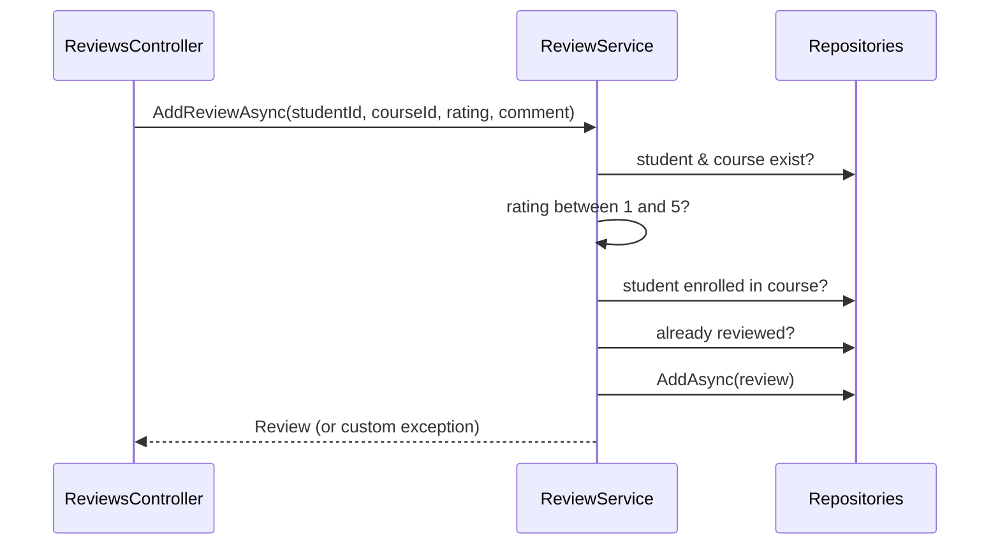

# Architecture Diagram


```
        MVC (Views + ViewModels)
                 │
                 ▼
            Controllers          thin: bind input, call a service, return a result
                 │
                 ▼
             Services            ALL business rules + custom exceptions + logging
                 │
                 ▼
           Repositories          only EF Core queries (no business rules)
                 │
                 ▼
            AppDbContext
                 │
                 ▼
            SQL Server
```

## Enroll flow



## Review flow


